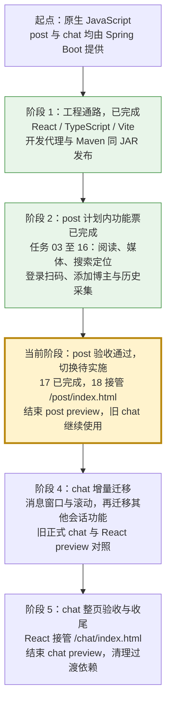

# React 迁移演进路线图与阶段计划

最近更新：2026-10-17。
分支：`codex/react-migration`。
当前进度：任务 01 至 17 已完成。post 的计划内功能与整页验收通过，已补齐正式 chat 导航、阅读成功摘要和最小桌面媒体布局。post 还剩 1 张主票：18 正式入口切换；该票尚未实施，正式 post 与 chat 仍是旧版。

本次验收：2026-10-17，任务 17 实施于 819bdb6、b421dbb、3193fd9。124 项 Chrome 回归与类型／双入口构建通过，干净 Maven verify 的 447 项测试通过，Standards／Spec 各 0 项。最终隔离 JAR 验证真实读取／搜索／媒体、三尺寸跨功能路径、四个新旧入口及直接资源／共享运行时 MIME；全部业务 POST 使用本地替身。发布包保存于 target/react-migration-release/ticket-17，哈希一致且 7z 完整性通过。完整证据和验证边界见 [任务 17](issues/17-post-page-acceptance.md)。Windows worker 原生退出问题本次未出现，继续独立留档，未认定修复。

任务 17 集成于 25a0847。主工作目录 5173 预览重启后，本地替身组合检查通过阅读摘要、最小桌面媒体、搜索／登录／添加／采集和开发正式 chat 导航；未请求用户业务接口。正式入口仍为旧版，下一票为 18。

## 总体演进路线图

本文件是 React 改造的总地图，统一维护阶段状态、入口切换、源码归属和完成条件。每次发布或完成任务更新这里；具体任务与验收证据放在 issues 中，共同约束放在 PRD 中。文件的演进历史保存在 codex/react-migration 分支的 Git 提交中。

| 阶段 | 状态 | 页面入口与源码如何演进 | 进入下一阶段的条件 |
| --- | --- | --- | --- |
| 1，工程通路 | 已完成，任务 01、02 | 新增 frontend 工程和两个 React preview；旧 post／chat 保持正式入口；Vite 产物经 target 纳入 Spring Boot JAR | 开发代理、生成资源、打包与独立 JAR 加载通过 |
| 2，post 增量迁移 | 计划内功能票完成，任务 03 至 16 | React post 的逐项阅读与交互已交付；新旧页面使用同一后端与本地数据；部分纯工具暂时复用 static/shared | 进入整页验收，检查逐项迁移遗漏、组合行为、纸感与生产资源 |
| 3，post 验收与切换 | 验收 17 已完成，切换 18 待细化 | 整页验收通过，下一票将 React 入口改为 /post/index.html；结束 post preview，清理 post 专属旧代码，保留旧 chat 所需共享文件 | 正式 post 验收通过，旧 JAR 与对应提交可回退 |
| 4，chat 增量迁移 | 尚未开始 | 在 React chat preview 迁移消息窗口、滚动和会话交互；正式 chat 继续使用旧实现 | chat 既有功能迁移完整，长列表、滚动、发送等行为与蓝色皮肤验收通过 |
| 5，chat 切换与收尾 | 尚未开始 | React 入口改为 /chat/index.html，结束 chat preview；整理共享工具与素材归属，清理替代掉的旧实现 | 两个正式 React 入口和同 JAR 发布通过，旧源码依赖与临时入口清理完成 |

### 当前位置与下一步

阶段 2 的计划内功能票和任务 17 整页验收已完成。已交付工程通路、post 默认阅读、博主单选、年／月／日导航、普通／纯转发文字、头像／认证、纸感对齐、图片卡片与查看器、视频、元信息／跳转、博主过滤、高级搜索与定位，以及登录扫码、添加博主和按时段采集。
整页验收发现的三项迁移缺陷已修复。124 项前端回归、447 项 Maven 全量测试、三尺寸组合路径、生产 JAR 与新旧资源共存通过，Standards／Spec 各 0 项。下一步是任务 18 的正式入口切换、回退与 post 专属旧实现清理。
chat 目前只有 React 入口骨架，业务迁移在阶段 4；本批没有提前切换 post 或迁移 chat。

### post 剩余主票估算

截至任务 17 完成，post 还剩 1 张主票。任务 18 的边界仍为工作轮廓，用户指定后再展开规格。未完成的旧需求（例如定时 View Refresh）继续留在原任务，不因迁移扩大范围。

| 暂定编号 | 剩余内容 | 当前状态 |
| --- | --- | --- |
| 17 | post 整页行为、纸感样式与打包验收 | 已完成，三项验收缺陷已修复 |
| 18 | post 正式入口切换、回退与专属旧实现清理 | 待细化 |

post preview 预计在任务 18 验收后结束；这是按完成条件估算的主票数，不承诺固定日期。

### 共享工具与源码归属的演进

当前 content.ts、PostFeed.tsx 仍复用旧 static/shared 中的 linkify.js、date.js，PostPreview.tsx 复用旧 post 的微博 SVG 素材。这是阶段 2 的过渡依赖，目的是保留既有链接与时间语义。
阶段 3 清理 post 时，旧 chat 仍有共享工具的消费方，需要保留其可用性；共存期间维持单一逻辑来源，并验证新旧页面。
在 chat 完成迁移、两页切换及最终清理过程中，将仍需使用的纯工具和素材整理到 frontend 内，清除 React 对旧页面源码目录的依赖。
最终 frontend 维护两个页面入口、组件、样式与共用工具；手写源码保留在 frontend，构建产物只进入 target，Spring Boot 继续提供同源 API 和最终静态资源。
整理源码归属时另设明确任务与验收，不在普通功能票中顺带移动或删除共享文件。

post preview 在阶段 3 结束，chat preview 在阶段 5 结束，两页各自验收、各自切换。结束条件由完整功能验收决定，当前没有承诺固定日期。

## 执行方式

先读取总纲和当前票，再按其依赖读取对应事实依据。
一次实现用户指定的一张票；完成相关检查并报告后，由用户决定下一票。
本批例外：2026-10-12，用户显式调用 implement-spec，授权已发布的任务 01 → 02 → 03 按依赖自动实施、验证和集成；其他未发布阶段仍需用户指定。
2026-10-17，用户明确授权“继续到 16 完成”，本批按 13 → 14 → 15 → 16 逐票实施、验证和集成；任务 17／18 仍待用户指定。
2026-10-17，用户在任务 16 完成后授权继续，实施并完成任务 17；任务 18 尚未实施。
后续票以已完成工作的实际接口和证据为前提，后续阶段只保留轮廓。
实现中出现范围或契约变化时，先记录并说明影响，调整当前任务；不顺带执行下一票。
`ready-for-agent` 表示任务内容已具体化，不表示依赖已完成，也不表示用户已指定开始。

## 当前任务

| 编号 | 交付 | Blocked by | 当前进度 |
| --- | --- | --- | --- |
| [01](issues/01-react-dev-preview.md) | 两个 React 预览入口可开发，post 显示现有查询返回的博主名称 | 无 | 已完成 |
| [02](issues/02-maven-generated-resources.md) | 干净 Maven 构建将预览页面与原页面一起打进可运行 JAR | 01 | 已完成 |
| [03](issues/03-post-default-day-reading.md) | 默认全部博主、最新有效日期的本地 Blogger Blog 阅读路径 | 02 | 已完成 |
| [04](issues/04-post-blogger-date-navigation.md) | 选择全部或单个博主，通过年／月／日时间轴阅读本地博文 | 03 | 已完成 |
| [05](issues/05-post-retweet-text-reading.md) | 转发原作者、正文与安全降级 | 04 | 已完成 |
| [06](issues/06-post-visual-alignment.md) | 已迁移区域视觉对齐、头像与认证显示 | 05 | 已完成 |
| [07](issues/07-post-image-cards.md) | 普通与转发图片展示、缩略图及失败隐藏 | 06 | 已完成 |
| [08](issues/08-post-image-viewer.md) | 原图查看、循环切图、键盘关闭与加载隔离 | 07 | 已完成 |
| [09](issues/09-post-video-cards.md) | 视频封面、跳转与转发去重 | 08 | 已完成 |
| [10](issues/10-post-metadata-links.md) | 卡片来源／地区、原文与头像主页跳转 | 09 | 已完成 |
| [11](issues/11-post-blogger-name-filter.md) | 左栏本地名称过滤、选择隔离与搜索框对齐 | 10 | 已完成 |
| [12](issues/12-post-advanced-search.md) | 高级搜索查询、日期与安全结果摘要 | 11 | 已完成 |
| [13](issues/13-post-search-location.md) | 搜索结果按日期定位与卡片高亮 | 12 | 已完成 |
| [14](issues/14-post-login-recovery.md) | 登录检测、扫码与 401 恢复 | 13 | 已完成 |
| [15](issues/15-post-add-blogger.md) | 添加博主与选择隔离 | 14 | 已完成 |
| [16](issues/16-post-sync-history.md) | 按时段采集历史与日期刷新 | 15 | 已完成 |
| [17](issues/17-post-page-acceptance.md) | 整页验收、迁移遗漏修复与正式切换前的发布证据 | 16 | 已完成 |

依赖为 01 → 02 → 03 → 04 → 05 → 06 → 07 → 08 → 09 → 10 → 11 → 12 → 13 → 14 → 15 → 16 → 17。任务 03 依赖已打通的开发、测试和发布资源路径，任务 04 在其默认读取路径上接入用户选择。
任务 03 是 post 阶段的起步切片；首阶段发布它以明确工程通路之后的第一条真实业务路径。

## 阶段与完成标准

1. 工程通路，任务 01 与 02。开发预览及独立 JAR 资源加载通过，原正式页面回归保持绿色。
2. post 阅读与交互。计划内任务 03 至 16 已完成，涵盖阅读导航、文字与媒体、纸感样式、搜索定位、扫码、添加博主及按时段采集。逐票验证通过，仍需下一阶段检查整页遗漏和组合行为。
3. post 切换。全部已实现功能回归通过，预览验收完成，保留旧产物后切换正式入口；旧 chat 保持可用。
4. chat 会话与交互。先验证消息窗口、动态高度和滚动锚点，再细化群选择、发送、历史、分析、表态、庆祝及既有特殊交互。
5. chat 切换与收尾。整页回归、长列表及打包验证通过，再切换正式入口并清理已替代的旧实现和临时预览入口。

阶段 2 已完成，阶段 3 已完成任务 17 验收，待任务 18 切换；阶段 4、5 仍保留轮廓，进入相应范围时再细化。
每页切换前检查完整已实现功能，不能仅凭任务 03 的最小路径通过就替换 post 正式入口。

## 验证与报告

- 首票建立当前两页测试基线，有既存失败时如实记录并与新增回归区分。
- 每票报告验收结果、实际验证、遗留问题和下一票的阻塞状态。
- 每票完成后检查差异并保存可回退提交；测试输出和构建产物保持为生成文件。
- 工程阶段检查开发代理、生成资源、classpath 静态资源、生产模块 MIME 与原页面资源共存。
- 整页切换阶段使用既有用户路径、视觉参照和生产产物验证。
- 生产冒烟直接覆盖最终 SQLite URL，使用隔离临时数据库、不存在的 Credential 文件和空自动采集群号。现有配置不能完全关闭调度；凭据缺失守卫在请求发出前拒绝外部采集，不将其表述为已关闭全部后台任务。

## 实施参考

仅在进入相关功能时读取其文档与源码，不要求每票加载全部参考。

| 场景 | 事实依据 |
| --- | --- |
| 所有任务的范围 | [PRD.md](PRD.md)、[访谈记录](DISCOVERY.md) |
| 领域行为 | [CONTEXT.md](../../CONTEXT.md) |
| Maven 与资源 | [pom.xml](../../pom.xml)、[应用配置](../../src/main/resources/application.yml) |
| UI 测试与 HTTP 替身 | [PostPageTest](../../src/test/java/xyz/fz/weibo/ui/PostPageTest.java)、[GroupChatPageTest](../../src/test/java/xyz/fz/weibo/ui/GroupChatPageTest.java) |
| post 查询接口 | [PostController](../../src/main/java/xyz/fz/weibo/controller/PostController.java) |
| post 初始选择与正文 | [post 入口](../../src/main/resources/static/post/post.js)、[博主](../../src/main/resources/static/post/bloggers.js)、[日期](../../src/main/resources/static/post/dates.js)、[博文](../../src/main/resources/static/post/posts.js) |
| 两套皮肤 | [DESIGN.md](../../docs/design/DESIGN.md) |
| post 导航与待办区别 | [三栏导航 ADR](../../docs/adr/0006-weibo-page-three-column-date-calendar-navigation.md)、[视图刷新 ADR](../../docs/adr/0005-weibo-page-view-refresh-only-no-sync-button.md)、[未完成的刷新任务](../weibo-post-page/issues/05-new-posts-banner-and-view-refresh.md) |
| chat 发送、扫码与滚动 | [发送语义 ADR](../../docs/adr/0002-send-does-not-write-to-store-directly.md)、[扫码 ADR](../../docs/adr/0007-headless-qr-login-inline-display.md)、[一次性落底 ADR](../../docs/adr/0008-scroll-to-bottom-is-one-shot.md) |

既有 chat 模块化 ADR 中“未引入构建工具”描述的是当时的实施范围，本次经用户确认新增构建工具。
若实现需要改变现有业务 ADR，先指出具体冲突并请用户决定，不能用技术迁移隐含覆盖它。

## 记录

2026-10-12，用户已确认范围、逐页切换、独立问题处理、逐票推进、产物回退和视觉一致性要求。
2026-10-12，本轮仅形成文档。当前没有通过的迁移验收项，也没有已完成的实现任务。
2026-10-12，用户调用 implement-spec，开始执行当前已发布的三票。集成分支沿用 codex/react-migration，逐票在独立 worktree 实施并合入。
2026-10-12，实施前基线通过：PostPageTest 37 项、GroupChatPageTest 82 项，共 119 项；无失败、错误或跳过。

2026-10-12，任务 01 集成于 8c80ba9。8 项 Chrome 浏览器测试、npm ci、类型检查、双入口构建与差异检查通过，包含组件和 CSS 热更新。默认 Chromium 下载未验收，本机 Chrome 已验证。

2026-10-12，任务 02 集成于 e15deb6。Maven 干净打包、120 项 UI 检查、前端错误阻断打包、隔离 JAR 同源查询、资源 MIME 与 7z 完整性／JAR 哈希检查通过；证据见票 02。

## 本批集成验收

2026-10-12，任务 03 集成于 13302f5，审查修正集成于 b051298。三张票均为 resolved，验收与各次验证证据见票正文。

- 前端最终 18 项真实浏览器检查通过，包含开发代理、热更新、默认日期读取、空数据、查询失败与局部重试、正文安全降级、卸载取消和开发正式页链接导航。类型检查与双入口构建通过。
- 在基于集成提交的独立 worktree 执行 `mvn clean verify`，431 项测试通过，零失败、错误或跳过，JAR 与 7z 打包成功。原两页的 119 项行为回归包含在内。
- 规范审查（Standards）发现 1 项计数排版问题，已修正为设计规定的 12px 等宽数字，复核无新增问题。
- 规格审查（Spec）发现 1 项开发正式页链接问题，已指向配置的后端，生产仍保持同源相对链接，复核无新增问题。
- 审查修正后执行 `mvn -Dtest=ReactPreviewPageTest package`，生成资源浏览器检查与最终打包通过；发布包再次通过 `7z t`。完整全量检查不因两处小范围修正重复运行。
- 独立 JAR 的默认阅读与新旧入口冒烟通过，详见票 03。测试使用临时 SQLite、缺少 Credential、空自动采集群号，未调用业务写接口。
- 主工作目录旧 JAR 正在运行并被占用，最终验证与打包采用独立 worktree。新产物保存于 `target/react-migration-release/weibo-plus.jar` 与同目录 `weibo-plus.7z`，未替换运行中的旧 JAR。
- 全量与最终打包日志保存在仓库外的研究笔记目录，分别为 `react-full-verify.log`、`react-final-package.log`。生成文件不进入 Git。
- 已向 Codex 提交 4 个受管实施／验证 worktree 的归档请求，工具返回 queued，当前尚未确认目录清理完成。任务 02 的冒烟临时目录删除被自动审批拒绝，仅返回 blocked by policy；测试进程已停止，临时证据保留。

本批只完成工程通路与 post 默认阅读切片。正式入口尚未切换；博主／日期切换、搜索、媒体查看和完整 chat 迁移继续按后续阶段推进。

2026-10-13，用户要求继续，先形成下一张 ticket。根据旧页面与接口确认任务 04 的单选、默认日期复位、年／月折叠、加载期间拒绝改选及响应隔离规则，发布规格并更新地图。本轮仅改文档，尚未实施或运行任务 04 验收。

2026-10-13，用户指定开始任务 04。按日期导航、博主范围联动、请求取消与恢复的纵向增量完成实现。25 项前端浏览器检查、类型检查、双入口构建、121 项 Java UI 定向检查、独立 JAR 导航与 MIME 冒烟均通过；Standards 与 Spec 审查各 0 项。证据见票 04，后续票仍待用户指定。

任务 04 集成提交为 5f651f1。发布产物另存于 target/react-migration-release/ticket-04/weibo-plus.jar 与同目录的 weibo-plus.7z，保存文件与验证产物 SHA-256 一致，7z 完整性检查通过。原运行中的 JAR 保持现状。本轮实施 worktree 的归档通过 Codex 提交，工具若返回 queued，则不将其记录为已确认清理完成。

2026-10-14，用户要求继续任务 05，完成转发作者与正文阅读。29 项前端浏览器检查、122 项 Maven UI 检查、类型与双入口构建、独立 JAR 冒烟通过，Standards 与 Spec 审查各 0 项。验收证据见票 05，正式入口保持旧版。

任务 05 集成提交为 3711da6。验证后的 JAR 和 7z 保存在 target/react-migration-release/ticket-05，保存文件与构建产物 SHA-256 一致，7z 完整性检查通过。实施 worktree 的归档由 Codex 处理，queued 仅表示请求已排队。

2026-10-14，用户指出旧 post 的链接已改为默认无下划线、悬停直线，React 仍沿用过时设计规则。独立修复 eb3161d（集成 957c0a0）同步 React CSS 与 DESIGN.md。真实浏览器先复现默认下划线错误，修正后普通／转发正文的默认与悬停样式通过；3 项构建资源检查及定向 package 通过。修正后的 JAR 与 7z 保存于 target/react-migration-release/ticket-05-link-fix，文件哈希一致且发布包完整性通过；迁移仍处于阶段 2。

2026-10-14，用户授权先处理已迁移区域的视觉偏差，发布并完成任务 06。实施 cf97736，34 项 Chrome 检查、类型与双入口构建、3 项 Maven 构建资源检查及独立 JAR 冒烟通过，Standards／Spec 各 0 项。已对比运行中的旧版与修正预览，并以相同 fixture 在两个桌面尺寸验证布局，另检查最小窗口与独立滚动。搜索行、媒体与互动区尚未迁移，不宣称整页像素一致。发布产物保存于 target/react-migration-release/ticket-06，仍处于阶段 2，下一候选为图片卡片。详细证据见票 06。

2026-10-14，用户指定继续，发布并完成任务 07。实施 6003f80、6867450，验证 9e24fe8；42 项 Chrome 检查、类型与双入口构建、4 项 Maven 构建资源检查及独立 JAR 本机图片上游冒烟通过，Standards／Spec 各 0 项。单图、多图和转发图片与旧版同数据几何对照通过，缩略图优先、原图回退、失败隐藏与长列表按需读取已验证。发布包保存于 target/react-migration-release/ticket-07，仍处于阶段 2；图片当前只展示，下一候选为图片查看器。

2026-10-15，完成任务 08 收尾并集成。实施 d129b25、0f20e44，验证 95aa63a；2026-10-14 已通过 50 项 Chrome、追加长列表关闭检查、类型与双入口构建、5 项 Maven 构建资源检查及独立 JAR 查看器冒烟。两项审查曾因额度中断，本日重新完成 Standards／Spec，各 0 项问题。查看器同数据几何对照、按需原图、循环与键盘切图、焦点／滚动恢复、加载竞态及卸载清理通过。发布包保存于 target/react-migration-release/ticket-08，仍处于阶段 2，下一候选为视频卡片；详细证据见票 08。

2026-10-15，用户确认继续，完成任务 09。实施 8907d0a、5843d29，失败封面占位独立修复 dccf33a，验证 8e3993d。最终 59 项 Chrome、类型与双入口构建、6 项 Maven 资源检查及独立 JAR 视频封面／安全跳转／去重／图片查看器共存验证通过，Standards／Spec 各 0 项。正常视频布局与旧版同数据对照通过，播放标识采用纸感硬投影；封面失败的旧 0×0 点击区域在 React 修正为已有尺寸的可用占位。发布包保存于 target/react-migration-release/ticket-09，仍处于阶段 2，下一候选为卡片元信息与跳转。详细证据见票 09。

2026-10-15，用户确认继续，完成任务 10。实施 d91614c、aa31ed5，打包验证 a71eb15；64 项 Chrome、类型与双入口构建、7 项 Maven 资源检查及独立 JAR 元信息／原文／头像主页与媒体共存检查通过，Standards／Spec 各 0 项。普通／纯转发完整卡片在两个桌面尺寸与旧版同数据对照通过，长来源省略、空字段及非法地址省略、外层原文和新窗隔离通过。发布包保存于 target/react-migration-release/ticket-10，仍处于阶段 2，下一候选为博主名称过滤，任务 11 尚未发布。详细证据见票 10。

任务 10 集成提交为 c8e4787。合入后主工作目录 Vite 预览以本机 HTTP 替身验证元信息、普通／纯转发及键盘新窗隔离通过，未调用现有后端业务接口或外部媒体。实施 worktree 通过 Codex 归档，queued 仅表示请求排队。

2026-10-16，用户反馈头像显示首字，独立修复 37645e0。真实 CDN 直连返回 403，而既有图片代理返回 200；React 侧栏与卡片头像改用 /chat/image，补齐 Vite 精确代理。64 项前端回归、类型与双入口构建、8 项 Maven 资源检查、Vite 与隔离 JAR 的真实头像加载通过，Standards／Spec 各 0 项。发布包另存于 target/react-migration-release/ticket-10-avatar-fix，详细证据见票 10。仍处于阶段 2，下一候选仍为博主名称过滤。

头像修正集成提交为 e45eb80。合入后现有 5173 预览的真实头像复现检查通过，实施 worktree 提交归档，queued 仅表示请求排队。

2026-10-16，用户反馈正文“查看图片”打开后 403，独立修复 e5296e2。带图片标识的微博 CDN 正文链接改用既有同源代理，保留新窗口与安全清洗，普通／转发共用；旧页、图片查看器与后端不变。66 项前端回归、类型与双入口构建、9 项 Maven 资源检查，以及 Vite／隔离 JAR 中截图对应原图的新窗显示通过，Standards／Spec 各 0 项。发布包另存于 target/react-migration-release/ticket-10-inline-picture-fix，详细证据见票 10。仍处于阶段 2。

正文图片修正集成提交为 2791ad8，当前 5173 预览的截图对应真实图片新窗检查通过。

2026-10-16，补充正文图片直连差异的根因：用户旧版使用 localhost，预览使用 127.0.0.1。固定图片 URL 和其余请求条件，仅改变 Referer，localhost 的 18080／5173 均为 200，127.0.0.1 的两个端口均为 403。此前隔离测试未对齐用户旧版主机名；差异来自 CDN 的来源处理，与 React 无关。代理修正保持，详细对照见票 10。

2026-10-16，用户要求继续，完成任务 11。实施 5f936a5，打包验证 a6460c9；70 项 Chrome、类型与双入口构建、10 项 Maven 资源检查及隔离 JAR 过滤／查询隔离／选择保持检查通过，Standards／Spec 各 0 项。名称过滤保持当前阅读，失败头像不重载，搜索框与列表在两个桌面尺寸与旧版对照通过，最小窗口独立滚动保持。发布包保存于 target/react-migration-release/ticket-11，仍处于阶段 2，下一候选为高级搜索与结果定位，任务 12 尚未发布。详细证据见票 11。

任务 11 集成提交为 a4a56b7，主工作目录 5173 预览以本机 HTTP 替身验证过滤及阅读／查询隔离通过。实施 worktree 提交归档，queued 仅表示请求排队。

2026-10-16，用户要求继续并询问 post 剩余票数，完成任务 12。实施 784a4e1、1cc7872、9dba8db，规范修正 27900e8，集成 30f3426。79 项 Chrome 回归、类型与双入口构建通过；规范修正后再通过 9 项搜索检查和构建。最终 Maven 11 项资源检查、独立 JAR 真实关键词／范围／日期查询、安全摘要与阅读隔离通过。Standards 的 1 项 P3 等宽数字问题已修正并复核，Spec 为 0 项；发布包保存在 target/react-migration-release/ticket-12。主工作目录 5173 的本地 HTTP 替身集成检查通过，无用户业务或外部媒体请求。

仍处于阶段 2，post 预计还剩 3 张主票（13 至 18），后续逐票细化；下一票接入搜索结果定位。post preview 预计在任务 18 整页验收及切换后结束，chat 另按阶段 4／5 推进。实施 worktree 提交归档，queued 仅表示请求排队；详细证据见票 12。

2026-10-17，完成任务 13，实施 99e71e6、4b624ac。86 项前端回归、类型／构建、12 项 Maven 资源检查、隔离 JAR 搜索定位及 MIME 验证通过，Standards／Spec 各 0 项。发布包 ticket-13。用户授权本批按序连续完成 13 至 16，逐票验证与提交；当前下一票为 14 登录与扫码，post 预计剩余 5 张主票。

任务 13 集成 d0267a4。主工作目录开发预览未运行，已隐藏启动 Vite；本地 HTTP 替身集成定位检查通过。证据 react-search-location-integrated-smoke.log；未请求用户业务数据或外部媒体。

2026-10-17，任务 14 完成，实施 9c3bc5b、55c4332，审查修正 9c5118d。完整 95 项前端回归、修正后 11 项登录检查、类型／构建、最终 13 项 Maven 资源及隔离 JAR 本地登录替身通过。Spec 两项 P2 已复现／修正／复核关闭，Standards 无问题。产物 ticket-14，下一票为添加博主，post 剩余 4 张主票。自动审批拒绝清理误运行生成的 .vite 目录，保留，不进入 Git。

任务 14 集成 5f09169，5173 本地 HTTP 替身扫码与阅读保持检查通过。任务 15 完成于 0111d0d，Spec 两项问题已修正复核，Standards 无问题；最终 108 项中 106 项通过，2 项原生进程退出后定向重跑通过，类型／构建、14 项 Maven 及隔离 JAR 添加替身通过，产物 ticket-15。测试运行稳定性另见独立问题，任务 17 复查。下一票为 16 历史采集。

任务 15 集成 65e1921。开发预览进程已退出后重新启动，5173 本地 HTTP 替身的登录／添加与阅读检查通过，证据 react-add-blogger-integrated-smoke.log；未触发真实业务写入。

2026-10-17，完成任务 16，实施 29a675d、2ea8b97。10 项定向、完整 118 项 Chrome 回归、类型／双入口构建、15 项 Maven 资源及隔离 JAR 采集替身／阅读保持通过，Standards／Spec 各 0 项。发布包 ticket-16。本批 13 至 16 完成，后续主票为 17 整页验收与 18 正式入口切换。

任务 16 集成 5b77a6d。主工作目录 5173 的组合检查覆盖搜索、扫码恢复、添加博主、采集和日期／正文保持，业务读取与 POST 均由本地替身拦截，未触发用户业务操作；证据 react-sync-history-integrated-smoke.log、react-sync-history-integrated.png。5173／18080 均在监听，未停止或替换用户后端。实施 worktree 归档已请求，queued 仅表示排队；任务 14 的诊断生成目录和工作树保留。
