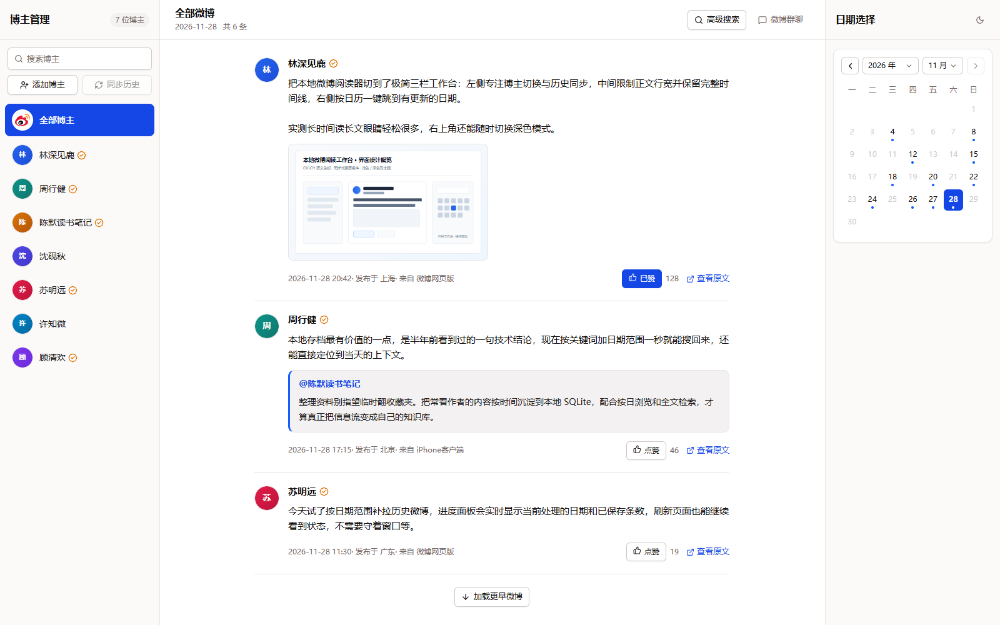
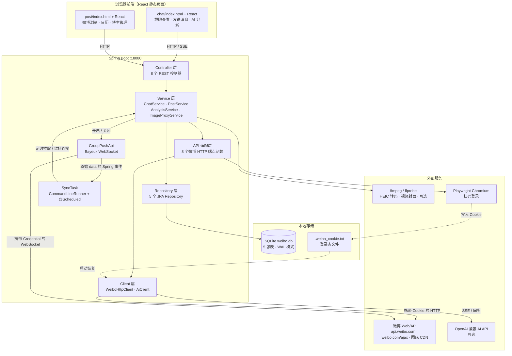

# vb-weibo-plus

本机单用户微博客户端。扫码登录后，服务会在后台将群聊消息和博主微博增量同步到本地 SQLite，并提供两个网页界面：

- **本地微博**：添加博主，按日历定位微博，滚动到底部连续加载更早日期的内容，支持按时间范围同步历史内容，以及使用当前微博账号点赞、取消点赞。可见微博按需查询当前已赞状态与点赞数。
- **微博群聊**：查看群聊消息，发送文字、图片和视频，可选接入 OpenAI 兼容模型进行 AI 分析。

图片和视频由本地服务代理，可直接在浏览器中查看，无需登录微博网页版。

## 页面预览

### 微博群聊


### 本地微博



## 系统架构

React 页面通过 HTTP／SSE 访问本地后端（默认 `:18080`）。后端负责微博 API、群聊 WebSocket、本地 SQLite、图片／视频代理和可选的 AI 分析。ffmpeg 用于 HEIC 图片转换和视频发送。下图以 Java 实现为例。

React 工程位于 `frontend/`。Java 后端位于 `backend/java/`，Rust 后端位于 `backend/rust/`。两个后端提供相同的前端入口，运行时选择其中一个。

### 整体分层



## 后端

默认端口为 `18080`。从仓库启动时，两个后端都使用根目录的 `weibo.db` 和 `.weibo_cookie.txt`。Windows x64 发布包从解压目录读取数据文件。切换后端前先停止当前进程。

HEIC 预览需要 ffmpeg，视频发送还需要 ffprobe。HTTP 示例见 [raws/](raws/)。

### Java

编译目标为 Java 21。Maven 构建和 Windows 发布包启动脚本均要求 JDK 21 或更高版本，允许使用任意补丁版本。

> **Java4Shell 安全更新（CVE-2026-114938）**
>
> 启动 Java 后端前，请使用已修复的 JDK。使用 Oracle JDK 21 时，请升级到 `21.0.13.1+4` 或更新的安全版本。其他发行版请以各自的安全公告为准。[OpenJDK 公告](https://openjdk.org/groups/vulnerability/advisories/2026-11-17) · [Oracle JDK 21 发布说明](https://www.oracle.com/java/technologies/javase/21all-relnotes.html#R21_0_13_1)
>
> 暂时无法升级 HotSpot 时，可以禁用 Base64 硬件加速路径。使用发布包时，将 `run.bat` 中的 `java -jar` 改为 `java -XX:-UseBASE64Intrinsics -jar`。从源码启动时，在 `backend/java/` 执行下面的命令。[漏洞披露方的缓解说明](https://calif.io/java4shell)
>
> ```powershell
> .\mvnw.cmd spring-boot:run "-Dspring-boot.run.jvmArguments=-XX:-UseBASE64Intrinsics"
> ```

从仓库根目录执行：

```powershell
cd backend/java
.\mvnw.cmd spring-boot:run
```

在 `backend/java/` 运行 `.\mvnw.cmd -Pquick test` 可快速检查后端。运行 `.\mvnw.cmd clean package` 生成 `target/weibo-plus-java.7z`，解压后双击 `run.bat` 启动。

### Rust

源码构建需要 Rust 和 Cargo。扫码登录需要本机 Chrome、Edge 或 Chromium，可通过 `WEIBO_CHROMIUM_PATH` 指定浏览器。从仓库根目录执行：

```powershell
npm.cmd --prefix frontend ci
npm.cmd --prefix frontend run build
cargo run --locked --manifest-path backend/rust/Cargo.toml
```

运行 `cargo test --locked --manifest-path backend/rust/Cargo.toml` 验证后端。执行 `& ./backend/rust/release/build.ps1` 生成 `backend/rust/target/weibo-plus-rust.7z`，解压后双击 `weibo-plus.exe` 启动。

构建两个后端后，运行 `node backend/rust/tests/java_interop.mjs` 验证接口和 SQLite 兼容性。

## 前端开发

前端代码位于 `frontend`，要求 Node.js 22.12.0 或更高版本、npm 10 或更高版本。先启动一个后端，再从另一个终端的仓库根目录运行：

```bash
cd frontend
npm ci
npm run dev
```

访问 `http://127.0.0.1:5173/post/index.html` 或 `http://127.0.0.1:5173/chat/index.html`。若后端使用其他端口，设置 `API_PROXY_TARGET`。

类型检查、构建与浏览器测试：

```bash
npm run typecheck
npm run build
npx playwright install chromium
npm test
```

前端独立构建输出到 `frontend/dist/`。测试默认使用 Playwright 自带的 Chromium，若已安装 Chrome，可设置 `PREVIEW_BROWSER_CHANNEL=chrome` 复用。

## 配置说明

主要配置位于 `backend/java/src/main/resources/application.yml`，部分配置支持环境变量覆盖：

| 配置项 | 环境变量 | 默认值 |
|--------|----------|--------|
| `server.port` | - | `18080` |
| `weibo.cookie-file` | - | `.weibo_cookie.txt` |
| `weibo.qr-timeout-seconds` | - | `300` |
| `weibo.database-path` | `WEIBO_DATABASE_PATH` | `weibo.db` |
| `weibo.chat.auto-sync-gids` | `WEIBO_AUTO_SYNC_GIDS` | `4761715839862414,5046020575330655` |
| `weibo.chat.sync-group-fixed-delay` | `WEIBO_SYNC_GROUP_FIXED_DELAY` | `1m` |
| `weibo.media.ffmpeg-path` | `WEIBO_FFMPEG_PATH` | `ffmpeg` |
| `weibo.ai.base-url` | `WEIBO_AI_BASE_URL` | 空 |
| `weibo.ai.api-key` | `WEIBO_AI_API_KEY` | 空 |
| `weibo.ai.model` | `WEIBO_AI_MODEL` | `deepseek-v4-flash` |
| `weibo.ai.timeout-seconds` | `WEIBO_AI_TIMEOUT` | `120` |
| `weibo.ai.system-prompt` | `WEIBO_AI_SYSTEM_PROMPT` | `请用中文回复分析结果。` |
| `spring.servlet.multipart.max-file-size` | - | `20MB` |
| `spring.servlet.multipart.max-request-size` | - | `21MB` |

`weibo.ai.base-url` 留空即禁用 AI 分析；`weibo.chat.auto-sync-gids` 留空则不同步任何群。如需修改 `server.port`，请直接编辑 yml。
