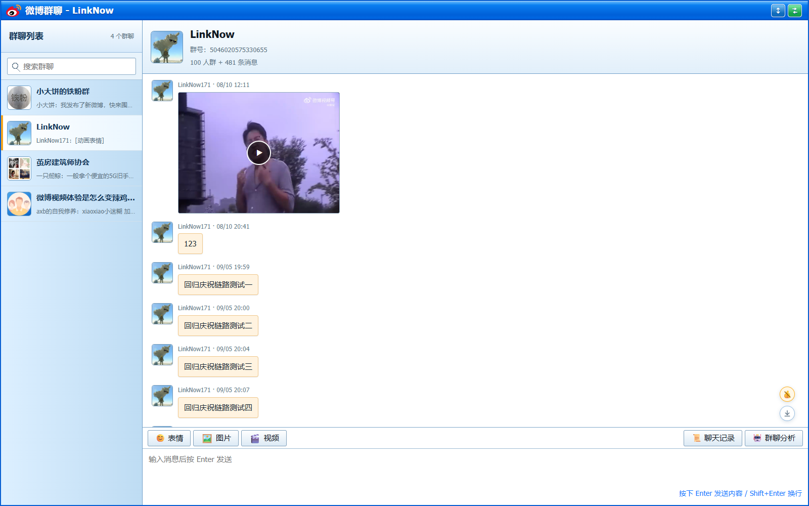
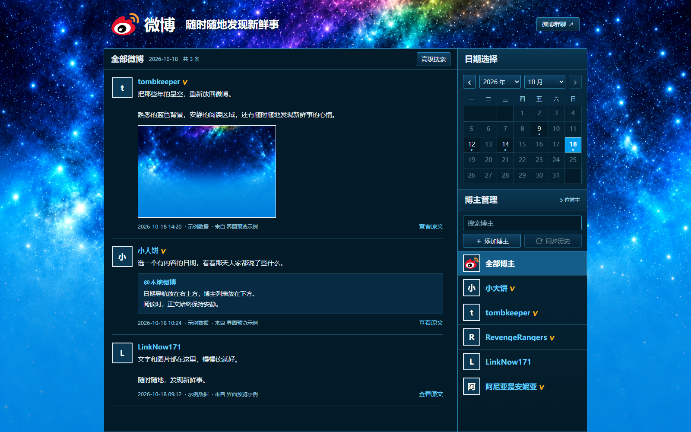
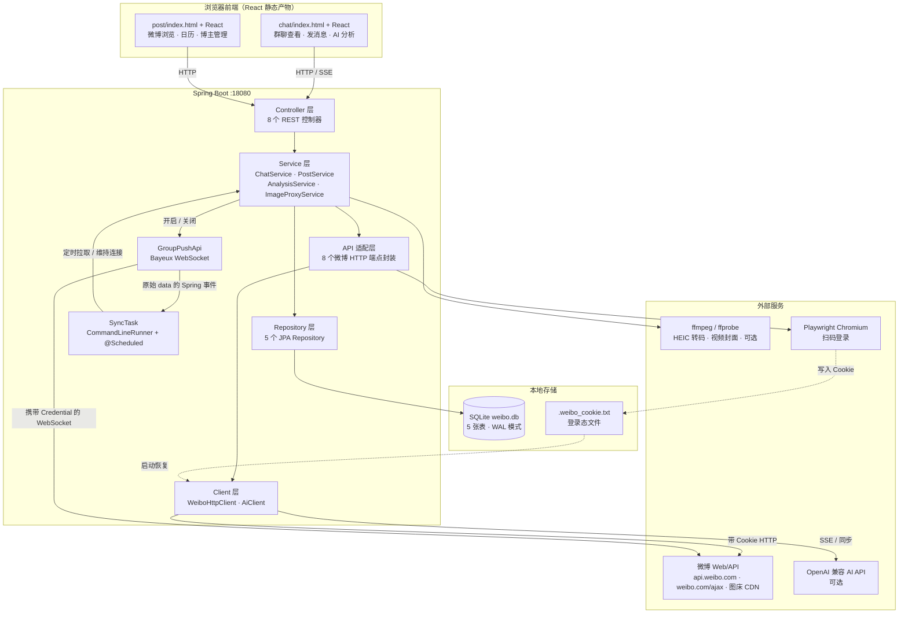

# vb-weibo-plus

本机单用户微博客户端。用一个微博账号扫码登录后，服务在后台将群聊与博主发布的最新微博增量同步到本地 SQLite，并提供两个网页界面：

- **本地微博**：添加博主，按日历浏览某一天的微博，支持按时间范围同步历史微博
- **微博群聊**：查看群聊消息、发送文字/图片/视频，可选接入 OpenAI 兼容模型的 AI 分析

所有微博图片、视频经本地服务代理后直接在浏览器预览，无需在浏览器中登录微博。

## 页面预览

### 微博群聊



### 本地微博



## 系统架构

### 整体分层



## 前置条件

- **JDK 21**
- **Maven 3.9+**
- **ffmpeg**（可选，但推荐安装）：群聊图片预览在遇到 HEIC 格式（苹果设备原图，微博会错标为 image/jpeg）时，依赖系统 ffmpeg 将其转码为 JPEG 以便桌面浏览器显示。未安装时 HEIC 图片会原样透传（浏览器无法显示），但不影响其他格式图片和其余功能。

#### ffmpeg 安装

将 ffmpeg 加入系统 PATH 即可，应用启动时会自动探测。

- **Windows**：下载 [ffmpeg](https://ffmpeg.org/download.html) 解压，将其 `bin` 目录加入 PATH；或设置环境变量 `WEIBO_FFMPEG_PATH` 指向 ffmpeg 可执行文件绝对路径。
- **macOS**：`brew install ffmpeg`
- **Linux**：`sudo apt install ffmpeg` 或对应发行版的包管理器。

若 ffmpeg 不在 PATH，可通过环境变量 `WEIBO_FFMPEG_PATH` 指定其路径，例如：

```bash
export WEIBO_FFMPEG_PATH=/path/to/ffmpeg
```

## 启动运行

```bash
mvn spring-boot:run
```

应用默认监听 `http://localhost:18080`。HTTP 接口集合见 `CHAT_API.http`、`POST_API.http`、`WEIBO_API.http`。

### React 前端开发

前端位于 `frontend`，需要 Node.js 22.12.0 或更新版本，以及 npm 10 或更新版本。本次验证使用 Node.js 24.15.0、npm 11.14.1。先启动上述 Spring Boot 服务，再在另一个终端运行：

```bash
cd frontend
npm ci
npm run dev
```

访问 [本地微博](http://127.0.0.1:5173/post/index.html) 或 [微博群聊](http://127.0.0.1:5173/chat/index.html)。修改组件或样式后自动热更新。两个正式入口均由 React 接管，开发与发布使用相同路径，切页按钮保持同源。两个 preview 入口均已移除。

开发请求使用相对路径，Vite 将 post 查询／媒体／采集、chat 群列表／消息／发送／表态／历史采集／分析，以及登录状态／扫码的精确 API 路径代理到 `http://127.0.0.1:18080`。两个 HTML、模块、图标和梦境页面由 Vite 提供。后端使用其他端口时，可设置 `API_PROXY_TARGET` 环境变量，或在 `frontend/.env.local` 中写入 `API_PROXY_TARGET=http://127.0.0.1:其他端口`。

`frontend/src/post` 和 `frontend/src/chat` 维护各页组件与皮肤；`frontend/src/shared` 维护共用日期、链接化、存储键与品牌素材。`frontend/public` 保存根路径图标及保持原 URL 的梦境页面。页面不再从 Spring Boot 的旧静态源码目录导入文件，旧 DOM 实现已移除。运行 Vite 或浏览器测试期间不要同时执行 `npm ci` 或默认 Maven 构建，它们重装依赖时可能遇到 Windows 的文件占用；先停止 Vite，构建完成后再启动。

post 支持博主过滤与日期导航、普通／纯转发正文、图片查看器、视频跳转、元信息、高级搜索及定位、扫码恢复、添加博主和按时段采集。每次点击博主会重新读取该范围日期并回到最新有效日；日列表加载期间拒绝日期切换，博主仍可切换；加载完成后再点同日会重新读取。列表沿用 `page=1`、`size=9999`，起止时间为所选日期的 `00:00:00` 与 `23:59:59`，由后端按 `Asia/Shanghai` 解释；页面总数显示后端 `total`。单博主的日期查询使用 uid，列表使用 uids。普通查询超时 15 秒，当日列表超时 30 秒，失败时保留后端消息；列表重试只重新读取当前博主的当日列表，不重载博主与日期。阅读不自动触发采集或定时 View Refresh，添加／历史采集仅在用户显式操作时提交。

查询依赖与请求清理遵循 TanStack Query 的[串行查询](https://tanstack.com/query/latest/docs/framework/react/guides/dependent-queries)与[查询取消](https://tanstack.com/query/latest/docs/framework/react/guides/query-cancellation)。正文经 [DOMPurify](https://github.com/cure53/DOMPurify) 清洗后呈现，链接化与上海时间复用现有共享原语；清洗失败时通过 React 文本节点安全降级。浏览器测试覆盖恶意富文本、后端错误、局部重试、空状态、旧响应隔离与卸载取消。导航查询按照[查询键](https://tanstack.com/query/latest/docs/framework/react/guides/query-keys)隔离博主、日期与每次主动范围选择；日期分组按 React 的[状态重置规则](https://react.dev/learn/preserving-and-resetting-state#resetting-state-with-a-key)，在新范围上重新展开默认日期。

```bash
npm run typecheck
npm run build
npx playwright install chromium
npm test
```

构建将两个 HTML 入口和 hash 资源写入专用目录 `target/generated-resources/frontend`，不写回手写源码目录。浏览器测试使用隔离的本地 HTTP 服务并经过真实 Vite 代理，无需运行 Spring Boot。

测试默认使用 Playwright 安装的 Chromium；已有 Chrome 时，可以省略浏览器下载，设置 `PREVIEW_BROWSER_CHANNEL=chrome` 后运行 `npm test`。PowerShell 中使用 `$env:PREVIEW_BROWSER_CHANNEL='chrome'`，本次开发预览验收使用此方式。

工程依据：React 的 [createRoot](https://react.dev/reference/react-dom/client/createRoot)、Vite 的[多入口构建](https://vite.dev/guide/build.html#multi-page-app)与[精确正则代理](https://vite.dev/config/server-options.html#server-proxy)，以及 TanStack Query 的[默认查询策略](https://tanstack.com/query/latest/docs/framework/react/guides/important-defaults)。查询将显式关闭自动重试、窗口聚焦和网络重连刷新，避免引入额外的 View Refresh。

### 构建和发布

```bash
mvn clean package
```

Maven 在 `generate-resources` 阶段安装固定的 Node.js 24.15.0 和 npm 11.14.1，执行 `npm ci` 和 `npm run build`（包含 TypeScript 检查）。工具链位于 `target/frontend-toolchain`，依赖位于 `frontend/node_modules`，首次构建需要联网。无需预先在系统中安装 Node.js；开发时运行 Vite 仍使用自己的 Node.js。

`process-resources` 将前端产物不经内容过滤复制到 `target/classes/static`，使 Java 浏览器测试读取与发布相同的构建文件。前端类型检查或构建失败会中止 Maven。使用 `clean` 清除过渡期的旧静态资源，避免把旧脚本或旧 JAR 带入新包；需要保留的回退包请先复制到 target 之外。页面测试需要 Playwright Chromium，首次运行会下载浏览器；已有相应版本的缓存时，可设置 `PLAYWRIGHT_SKIP_BROWSER_DOWNLOAD=1`。

最终 `target/weibo-plus.jar` 同时包含两个 React 正式页面、共用构建资源及梦境页面；`target/weibo-plus.7z` 包含该可执行 JAR 与 `run.bat`。发布后只需 JDK 21，无需 Vite 或 Node.js 进程；页面使用同源相对接口地址。启动 JAR 后访问 `http://localhost:18080/post/index.html` 或 `http://localhost:18080/chat/index.html`。两个 preview、旧 post／chat 和旧 shared 运行时均不再打包。

只检查页面资源集成时，可运行 `mvn clean package -Dtest=PostPageTest,GroupChatPageTest`。两个 PageTest 验证实际构建后的 React 正式页面。隔离生产冒烟应在唯一临时工作目录启动 JAR，直接指定 `spring.datasource.url=jdbc:sqlite:临时数据库绝对路径?busy_timeout=5000&journal_mode=WAL`，同时设置 `weibo.database-path` 为同一路径、`weibo.cookie-file` 为不存在的临时文件、`weibo.chat.auto-sync-gids=` 和 `server.address=127.0.0.1`，使用空闲端口。空群号不能关闭所有后台调度；缺少 Credential 时，外部采集在请求构造阶段被拒绝。查询使用临时数据，业务写操作应由本地替身拦截，不使用生产数据库或登录凭据。

post 切换的回退基线为提交 `2cc6ef8` 和已验证的 `target/react-migration-release/ticket-17/weibo-plus.jar`，其 SHA-256 为 `932A7FF0E63847C1FFB39321DE3469801950CFFC7E3C822795AF3328CB288C58`。部署前保存原 JAR、配置与数据库备份；需要回退时停止新版，用原工作目录、相同配置和原端口启动该旧 JAR。此迁移没有数据库或配置格式变更，不需要清空数据库。重新构建旧源码时，应在独立检出中使用上述提交，避免覆盖正在工作的目录。迁移进度与逐票证据见 [.scratch/react-migration/PLAN.md](.scratch/react-migration/PLAN.md)。

chat 切换的回退基线为提交 `68b0dec` 和 `target/react-migration-release/ticket-34`（JAR SHA-256 `53A726F35E46667EE00DE38EC943CE67429D5C4D593A2C47CA989455C1853C7D`，7z `16EEE75E2276C51BA4E959EE947D9859C41A07AE31C5F9A4BED24B6CD235C175`）。最终包保存于 `target/react-migration-release/ticket-35`：JAR SHA-256 `DB1711E80F009B3290ECDF974422A8B0A5582D61CBBF91ACE1EBF9CF2F38535A`，7z SHA-256 `EE7305BC34DDAA606C926290CB1BEA1B8235EF1B45E0DB6A2EEAAD2862FC5532`。需要回退时停止新版，用原工作目录、相同配置与端口启动 ticket-34 的 JAR；迁移未改动数据库或配置格式。

构建配置依据：[Maven 生命周期](https://maven.apache.org/guides/introduction/introduction-to-the-lifecycle.html)、[frontend-maven-plugin](https://github.com/eirslett/frontend-maven-plugin)和 [Spring Boot 可执行 JAR 打包](https://docs.spring.io/spring-boot/3.5/maven-plugin/packaging.html)。

也可直接使用 `run.bat` 启动：将打包产物 `weibo-plus.jar` 放到 run.bat 同目录后双击运行。脚本会自动检查 JDK 版本（要求 21 及以上），并以固定参数启动服务（端口 18080、默认同步群号 `4761715839862414`、AI 指向 DeepSeek），启动 5 秒后自动打开群聊页面。如需调整参数，直接修改 run.bat 中 java 命令行的值即可。

### 配置说明

主要配置项在 `src/main/resources/application.yml`，均可通过环境变量覆盖：

| 配置项 | 环境变量 | 默认值 |
|--------|----------|--------|
| `server.port` | - | `18080` |
| `weibo.cookie-file` | - | `.weibo_cookie.txt` |
| `weibo.qr-timeout-seconds` | - | `300` |
| `weibo.database-path` | `WEIBO_DATABASE_PATH` | `weibo.db` |
| `weibo.chat.auto-sync-gids` | `WEIBO_AUTO_SYNC_GIDS` | `4761715839862414,5046020575330655` |
| `weibo.chat.sync-group-fixed-delay` | `WEIBO_SYNC_GROUP_FIXED_DELAY` | `1m` |
| `weibo.media.ffmpeg-path` | `WEIBO_FFMPEG_PATH` | `ffmpeg` |
| `weibo.ai.base-url` | `WEIBO_AI_BASE_URL` | 空 |
| `weibo.ai.api-key` | `WEIBO_AI_API_KEY` | 空 |
| `weibo.ai.model` | `WEIBO_AI_MODEL` | `deepseek-v4-flash` |
| `weibo.ai.timeout-seconds` | `WEIBO_AI_TIMEOUT` | `120` |
| `weibo.ai.system-prompt` | `WEIBO_AI_SYSTEM_PROMPT` | `请用中文回复分析结果。` |
| `spring.servlet.multipart.max-file-size` | - | `20MB` |
| `spring.servlet.multipart.max-request-size` | - | `21MB` |

各配置项说明：

- `server.port`：应用监听端口，改端口需直接修改 yml
- `weibo.cookie-file`：登录态 cookie 文件路径
- `weibo.qr-timeout-seconds`：扫码登录等待确认的超时秒数，超时后报「扫码登录超时」
- `weibo.database-path`：本地 SQLite 数据库路径
- `weibo.chat.auto-sync-gids`：自动接收和增量同步的群号，逗号分隔，留空则不同步任何群
- `weibo.chat.sync-group-fixed-delay`：群消息定时增量拉取间隔，默认每 1 分钟执行一次，与 WebSocket 连接状态无关，支持 `1m` / `60000ms` 等 Duration 写法
- `weibo.media.ffmpeg-path`：ffmpeg 可执行文件路径
- `weibo.ai.base-url`：OpenAI 兼容 API 地址，留空则禁用 AI 分析
- `weibo.ai.api-key`：AI API 密钥
- `weibo.ai.model`：模型名称
- `weibo.ai.timeout-seconds`：AI 请求超时秒数
- `weibo.ai.system-prompt`：系统提示词
- `spring.servlet.multipart.max-file-size`：群聊发图/发视频的单文件上传上限，需容纳手机原图
- `spring.servlet.multipart.max-request-size`：整个 multipart 请求上限，略大于文件上限即可
