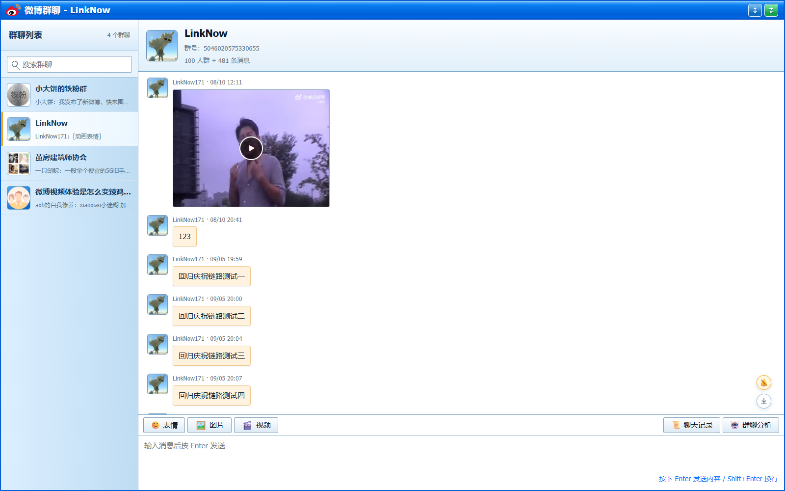
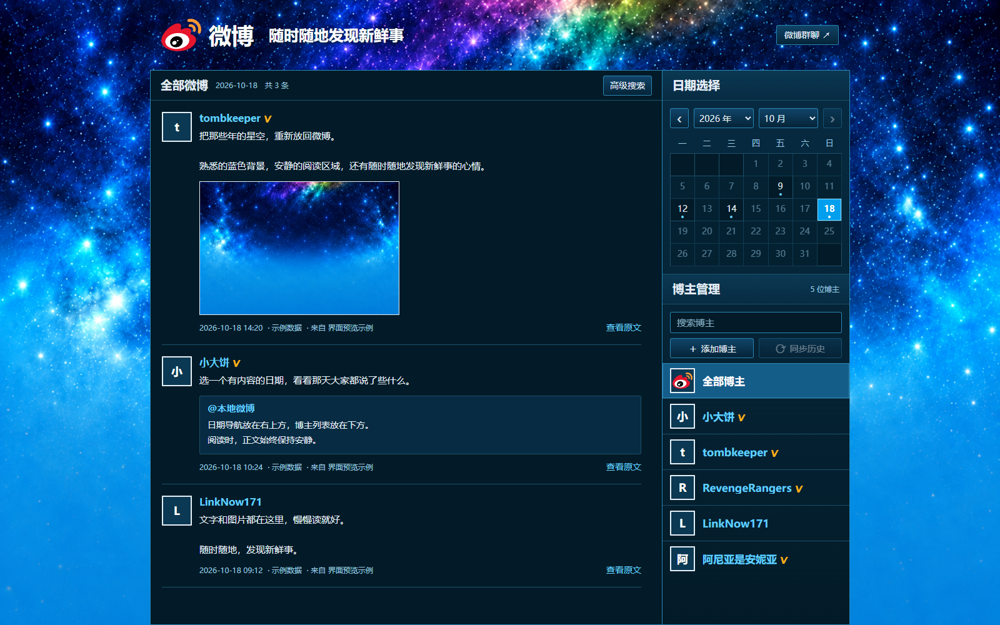
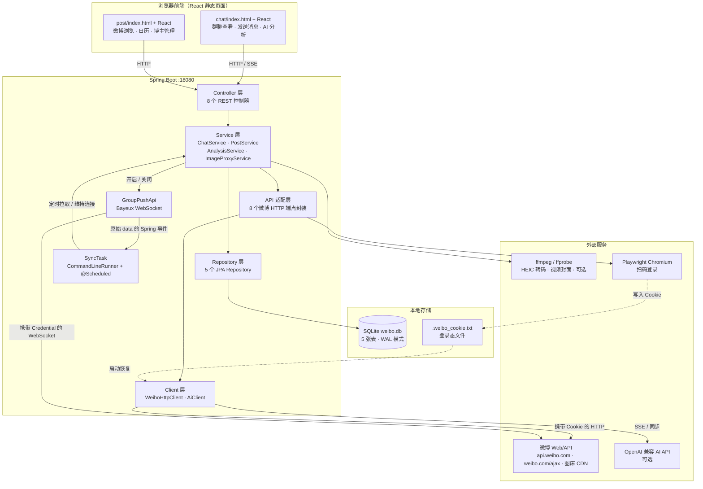

# vb-weibo-plus

本机单用户微博客户端。扫码登录后，服务会在后台将群聊消息和博主微博增量同步到本地 SQLite，并提供两个网页界面：

- **本地微博**：添加博主，按日历定位微博，滚动到底部连续加载更早日期的内容，支持按时间范围同步历史内容，以及使用当前微博账号点赞、取消点赞。可见微博按需查询当前已赞状态与点赞数。
- **微博群聊**：查看群聊消息，发送文字、图片和视频，可选接入 OpenAI 兼容模型进行 AI 分析。

图片和视频由本地服务代理，可直接在浏览器中查看，无需登录微博网页版。

## 页面预览

### 微博群聊



### 本地微博



## 系统架构

React 页面通过 HTTP／SSE 访问 Spring Boot（默认 `:18080`）。后端负责微博 API、群聊 WebSocket、本地 SQLite、图片／视频代理，以及可选的 AI 分析；ffmpeg 可选，用于 HEIC 图片转码等媒体处理。

### 整体分层



## 前置条件

- **JDK 21**
- **Maven 3.9+**
- **ffmpeg**（可选）：用于 HEIC 图片转码。未安装时 HEIC 图片无法预览；将 ffmpeg 加入 PATH，或通过 `WEIBO_FFMPEG_PATH` 指定路径。

## 启动运行

```bash
mvn spring-boot:run
```

默认监听 `http://localhost:18080`。接口示例见 `CHAT_API.http`、`POST_API.http`、`WEIBO_API.http`。

也可以将 `weibo-plus.jar` 与 `run.bat` 放在同一目录后双击运行。脚本内置端口、同步群号等参数，可直接在 `run.bat` 中修改。

## 前端开发

前端代码位于 `frontend`，要求 Node.js 22.12.0 或更高版本、npm 10 或更高版本。请先启动 Spring Boot，再运行：

```bash
cd frontend
npm ci
npm run dev
```

访问 `http://127.0.0.1:5173/post/index.html` 或 `http://127.0.0.1:5173/chat/index.html`。若后端使用其他端口，设置 `API_PROXY_TARGET`。

类型检查、构建与浏览器测试：

```bash
npm run typecheck
npm run build
npx playwright install chromium
npm test
```

测试默认使用 Playwright 自带的 Chromium；若已安装 Chrome，可设置 `PREVIEW_BROWSER_CHANNEL=chrome` 复用。

## 后端检查

```bash
mvn -Pbackend-check clean test
```

此命令执行 Java lint、编译和全部后端测试，跳过前端工具链安装、依赖安装及构建，并在发布打包前结束。检查产物独立写入 `target/backend-check`，避免清理正在使用的发布包。该 profile 排除 `xyz.fz.weibo.ui` 包中依赖前端产物的浏览器测试，普通构建仍运行这些测试。只检查 Java 源码时可运行 `mvn validate`。

- **Checkstyle**：绑定 `validate` 阶段，检查生产和测试 Java 源码。禁止普通星号导入（允许静态星号导入）、`System.out`、`System.err` 和 `printStackTrace()`；空 catch 必须有忽略原因注释。工具只检查注释存在，原因是否合理仍需人工审查。规则位于 [config/checkstyle.xml](config/checkstyle.xml)。
- **补充源码检查**：禁止无用和冗余导入；控制语句必须带大括号；`equals()` 与 `hashCode()` 必须配套重写；检查未说明的 `switch` 分支贯穿；修饰符顺序遵循 Java 约定；每个文件只允许一个顶层类型。保留现有缩进、换行与测试命名约定。
- **SpotBugs**：绑定 `process-classes` 阶段，以最高分析强度检查生产字节码，仅高优先级问题阻断构建，不分析测试字节码。后端检查报告位于 `target/backend-check/spotbugsXml.xml`，普通构建的报告位于 `target/spotbugsXml.xml`。

这些门禁也默认参与 `mvn test` 和 `mvn package`。首期不启用全套格式规则，不建立历史违规基线。若确认存在误报，只能按具体类、方法和问题类型添加精确排除并注明理由，再通过 `pom.xml` 中的 `excludeFilterFile` 接入；不得整包屏蔽，也不要通过跳过检查解决违规。

配置参考：[Checkstyle Maven 插件](https://maven.apache.org/plugins/maven-checkstyle-plugin/check-mojo.html)、[语法树规则](https://checkstyle.org/checks/coding/matchxpath.html)、[SpotBugs 构建门禁](https://spotbugs.github.io/spotbugs-maven-plugin/examples/violationChecking.html)及[误报过滤](https://spotbugs.readthedocs.io/en/stable/filter.html)。

## 构建和发布

```bash
mvn clean package
```

产物为 `target/weibo-plus.jar` 和 `target/weibo-plus.7z`。首次构建会自动安装前端依赖；运行时只需 JDK 21。

发布包仅保留 Windows x64 的 Playwright 驱动，扫码登录需在 Windows x64 上运行。

## 配置说明

主要配置位于 `src/main/resources/application.yml`，部分配置支持环境变量覆盖：

| 配置项 | 环境变量 | 默认值 |
|--------|----------|--------|
| `server.port` | - | `18080` |
| `weibo.cookie-file` | - | `.weibo_cookie.txt` |
| `weibo.qr-timeout-seconds` | - | `300` |
| `weibo.database-path` | `WEIBO_DATABASE_PATH` | `weibo.db` |
| `weibo.chat.auto-sync-gids` | `WEIBO_AUTO_SYNC_GIDS` | `4761715839862414,5046020575330655` |
| `weibo.chat.sync-group-fixed-delay` | `WEIBO_SYNC_GROUP_FIXED_DELAY` | `1m` |
| `weibo.media.ffmpeg-path` | `WEIBO_FFMPEG_PATH` | `ffmpeg` |
| `weibo.ai.base-url` | `WEIBO_AI_BASE_URL` | 空 |
| `weibo.ai.api-key` | `WEIBO_AI_API_KEY` | 空 |
| `weibo.ai.model` | `WEIBO_AI_MODEL` | `deepseek-v4-flash` |
| `weibo.ai.timeout-seconds` | `WEIBO_AI_TIMEOUT` | `120` |
| `weibo.ai.system-prompt` | `WEIBO_AI_SYSTEM_PROMPT` | `请用中文回复分析结果。` |
| `spring.servlet.multipart.max-file-size` | - | `20MB` |
| `spring.servlet.multipart.max-request-size` | - | `21MB` |

`weibo.ai.base-url` 留空即禁用 AI 分析；`weibo.chat.auto-sync-gids` 留空则不同步任何群。如需修改 `server.port`，请直接编辑 yml。
